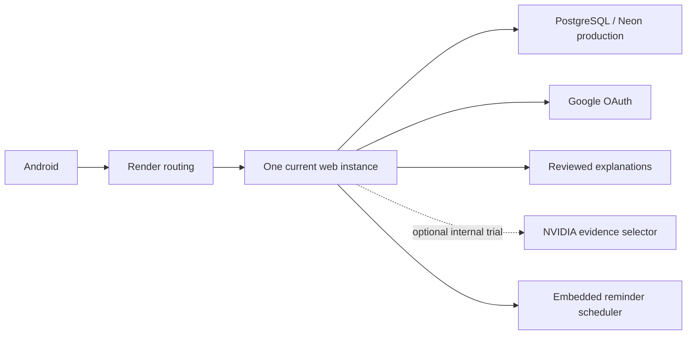

# Backend reliability and capacity — 2026-11-09

**Production decision: NO-GO.** This is an isolated engineering branch, not a
deployment, a measured 100k-user capacity claim, or a 99.9% availability guarantee.
No production/hosted-staging load or chaos experiment, paid service, migration,
Play upload or learner-data mutation was performed.

Statuses: **TESTED** = observed actual execution; **SIMULATED** = mocked dependency
or synthetic workload; **PLANNED** = not executed; **BLOCKED** = missing resource,
credential or approval. Passing a mock is not passing a real provider or failover.

## 1. Current backend architecture — TESTED inventory

Read-only Render API observed one configured/running Free instance for production
and one for staging, both Oregon. Production service srv-d99id4mcjfls738a8l80:
main/auto-deploy on, Live e97c029, command `uvicorn main:app --host 0.0.0.0 --port $PORT`,
health `/health`. Staging srv-dbniform8hqs73caemig: recovery branch/auto-deploy off,
Live cc239d0, same single-worker command. Neither was changed.

FastAPI/Starlette ASGI, synchronous SQLAlchemy sessions and PostgreSQL/psycopg2.
Some async routes still perform synchronous DB work on the event loop; slow DB
operations can stall it. Google requests already use worker threads and 15-second
timeouts. The optional evidence selector has two provider slots; reviewed source
explanations remain available without an external provider. JWT/refresh/OAuth
grants are database-backed; signed cookie/JWT secrets must remain identical across
replicas. Source validators and immutable process caches stay enabled.

Render CPU/memory GETs over the provider's default last-hour window: production
CPU limit 0.15, observed CPU mean 0.001874/max 0.002662 in provider units; memory
limit 536,870,900 bytes, observed max 195,584,000 bytes (about 187 MiB). These are
61 samples of the old production code at low traffic, not a new-branch capacity
test. Staging returned no samples in that window; zero samples is not zero usage.
Initial explicit-time queries returned 400; standard-window queries succeeded.
Published Free specs list 0.1 CPU/512 MB, so the observed CPU limit is recorded
separately rather than replaced by documentation. Sentry is not configured on
either inspected service. External private AI config was absent.

## 2. Confirmed weaknesses and fixes

Four initial regressions failed before changes and passed after changes:
unbounded/default DB pool policy, Docker's four embedded scheduler processes,
Sentry's incorrectly nested credential filter and repeated AI failures without a
circuit breaker. Additional confirmed issue: study-help kept the request's read
transaction/connection while awaiting optional inference.

Implemented: explicit pool/timeouts; safe TCP probe close; connection release
before inference; 3-failure/30-second circuit with one half-open probe; bounded
ASGI admission and separate auth/help ceilings; independent liveness/readiness;
secret-free aggregate metrics; telemetry allowlisting; bounded server launcher.
No retry of database writes or scientific content change was introduced.

## 3. Single points of failure and scale gates

One Free web instance is a confirmed SPOF; Free cannot scale horizontally and can
sleep after idle. A single production database endpoint remains a dependency;
its plan, replication/failover entitlement and regional recovery are not verified.
Local uploads/files, legacy process state and embedded scheduler jobs prevent a
claim of fully stateless/HA operation. Source caches are per-process and rebuild
from pinned sources; optional cache loss must not bypass source validation.

The launcher defaults to one worker and refuses multiple workers unless
SCHEDULER_ENABLED=false. The scheduler independently checks APP_WORKERS. This is
configuration safety, not distributed leader election or exactly-once delivery.
Do not bypass the launcher with arbitrary `uvicorn --workers 4`; a single worker
on each of two replicas would still duplicate reminders unless the embedded
scheduler is disabled everywhere. A durable outbox, single separately managed
scheduler/worker, shared rate/budget controls and storage are PLANNED before HA.

## 4. Database reliability

New per-process defaults: pool size 5, overflow 0, checkout wait 2s, pre-ping,
300s recycling/LIFO, connect timeout 3s, statement timeout 15s, lock timeout 2s,
idle-in-transaction timeout 30s, hidden SQL parameters. All have validated bounds.
Original TLS URL settings are retained. Invalid settings fail closed; production
still refuses silent SQLite fallback. Offline imports/migrations must explicitly
review their own longer timeouts, not raise all API limits.

Budget: replicas × workers × (pool_size + max_overflow), plus independent jobs,
maintenance and provider-reserved connections. PostgreSQL max_connections/role
limits and active query distribution were not newly sampled. Do not choose a
replica count from this formula without the DB operator's actual budget.

New PG tests require the explicitly provisioned loopback staging database file:
50 duplicate synthetic inserts through ten threads, owned stale-connection
termination/reconnect, and a child worker crash before commit with rollback and
successful reuse of the same key. They create/drop only random owned schemas.
Locally **3 skipped**, not passed: no isolated PG URL provisioned for this run.
They are included in the branch's full CI with its private PostgreSQL 18 service.
They do not replace original real grading/XP concurrency tests.

## 5. NVIDIA isolation and fallback

Existing two-slot provider limit is preserved. Circuit opens after three failed
selections for 30s; only one half-open probe is admitted. Quota/Retry-After refusals
are not counted as new upstream failures and do not extend provider cooldowns.
402/403 still stop the pool; 429/Retry-After pauses it globally. No quota/account
hopping, added upstream retry loop, billing change or free-form fact generation.

Study-help now closes its read-only DB session before optional inference; pending
writes are rejected rather than silently committed/discarded. Actual copied-course
API test observed **zero checked-out connections inside the provider call**.
Correct/wrong MCQ/FRQ and source feedback regressions passed. Slow/failing provider
and fallback behavior are SIMULATED. The eight earlier credentials returned 401;
real NVIDIA inference remains BLOCKED. No new external AI requests were made here.

Cancellation releases HTTP admission; it does not forcibly kill blocking Python
threads or undo committed writes. Provider sockets retain existing timeouts;
there is no newly claimed hard end-to-end inference deadline. Dedicated execution
workers/HTTP cancellation and distributed budgets need further measured design.

## 6. Authentication reliability

Google-only UI, stable verified Google subject, PKCE/state consumption, token
validation/refresh and account isolation were preserved. Auth/startup regression
cases are included in the 159-test local run. Existing email-only linking guard
remains fail-closed. New auth admission ceiling defaults to eight per process;
this is not per-user/distributed rate limiting. Google/network load was mocked;
no artificial Google traffic was sent. Legacy recovery and old-client production
upgrade acceptance remain release gates described in the existing audit.

## 7. Load testing approach and actual execution

Chose existing pytest/httpx plus psutil for a small, dependency-light component
lab. Locust is suitable for future stateful account journeys and distributed
workers; k6 for HTTP throughput/thresholds. Neither was installed or used to
manufacture results on this memory-limited machine. requirements-reliability.txt
is test-only. No full backend/production endpoint benchmark was run.

`scripts/reliability/component_lab.py` has **no target URL option**. It creates
only an in-process ASGI app, disposable SQLite ledger, synthetic JWTs and mocked
AI. No main import, Google/NVIDIA calls, real account or hosted database. It
requires free RAM/disk, caps requests, aborts on unexpected 5xx/timeouts, process
RSS >192 MiB or free system RAM <384 MiB. Larger-than-ten-user runs are refused
pending separate resource/operator review even when resources appear available.

First experiment started every virtual user on AI, hit the four-request help
ceiling, returned 503 and automatically aborted: retained as failure evidence.
The workload was corrected to stagger the declared endpoint mix, not to raise
the bulkhead. A mixed 1/2/5/10-user run completed. A later run of the stricter-cap
script refused to start with 433 MB free RAM. Both outcomes are retained; the
latest workload implementation is not misrepresented as re-benchmarked.

## 8. Chaos experiments

| Scenario | Hypothesis / expected behavior | Blast radius and stop/recovery | Observed status |
| --- | --- | --- | --- |
| A: provider fails | Reviewed fallback, core still answers | Mock only; stop unexpected 5xx, restore flag | SIMULATED: fallback and core 200 |
| B: DB unavailable | No false success; live stays alive; recover | Component DB-error flag; clear it and retry a read | SIMULATED: 503/live200/recovered200; real PG reconnect test pending CI |
| C: worker dies | Uncommitted write rolls back | Only child Popen created by test, owned schema; 15s ack/5s stop bounds | PLANNED/CI pending; no real HTTP replica failover accepted |
| D: latency/cancel | Bounded wait, admission released | Synthetic delayed GET, 5ms cancellation | SIMULATED: cancelled and inflight released |
| E: optional cache loss | Safe uncached path, no validation bypass | Synthetic cache flag, restored afterward | SIMULATED: 200; no Redis outage claim |
| F: pressure | Reject excess, avoid unbounded waiting | Fixed admission/resource gates; automatic abort | TESTED guards; first burst aborted; no OOM/CPU exhaustion induced |
| G: partial dependency | Provider outage does not consume core pool | Mock provider + released read session | SIMULATED isolation and real source-route connection-release test |

Synthetic committed-response loss followed by replay produced one award row/sum10,
not two. This is a SQLite fixture result, not proof of real PostgreSQL grading or
cross-region exactly-once semantics. External side effects require an outbox and
idempotent recipients; no automatic mutation replay was added.

## 9. Latency measurements — SIMULATED only

Earlier mixed component sample, in-process/client+server, no network/real provider:

| Phase | Users | Requests | RPS | p50 ms | p95 ms | p99 ms | Errors |
| --- | ---: | ---: | ---: | ---: | ---: | ---: | ---: |
| Baseline | 1 | 31 | 14.84 | 1.983 | 34.236 | 41.772 | 0% |
| Small | 10 | 469 | 152.12 | 1.036 | 37.017 | 41.796 | 0% |
| Ramp | 2 | 62 | 30.20 | 1.260 | 34.008 | 34.455 | 0% |
| Ramp | 5 | 155 | 75.70 | 1.166 | 33.892 | 38.525 | 0% |
| Ramp | 10 | 320 | 156.01 | 0.926 | 34.692 | 39.788 | 0% |
| Spike | 10 | 321 | 155.26 | 0.922 | 36.577 | 42.170 | 0% |
| Short smoke | 10 | 1001 | 152.81 | 0.986 | 35.800 | 42.637 | 0% |

The old per-phase cap overshot by one outstanding request; now admission reserves
the shared cap before awaiting. The updated script's next run was resource-blocked,
not silently substituted. The final short sample lasted 6.55s: **not an endurance
test**. Synthetic DB flag recovery was 1.217ms, not PostgreSQL/region RTO.

## 10. RPS and concurrency interpretation

The table does not measure main:app capacity, real HTTP transport, OAuth latency,
production XP, 50/100/500/1000 concurrent users or maximum sustainable throughput.
Those are BLOCKED locally by resource limits. The full workload plan below must
run on a newly owned service/DB with synthetic users, never shared staging.
Initial ramp: 10 for 60s, then 50 for 120s only if resource/error gates pass; stop
at >1% unexpected errors, p95 >2s for 30s, RSS >70% budget, DB pool >70% sustained,
or loss of idempotency/account isolation. Approve 100/500/1000 stages separately
after capacity review. Long soak: at least 60min at accepted safe concurrency,
with fresh session/refresh and stable heap/connection checks; not executed here.

## 11. CPU/RAM and queue interpretation

Component process peak RSS was about 70.6 MB; the 10-user short sample used about
23.4% of one CPU, including the in-process load client. DB checkouts returned to
zero after each phase. Admission has no application wait queue; executor/socket
queue lengths were not measured. The recorded older field naming is corrected in
the current script. Real production CPU/RAM above describe e97c029, not this build.

## 12. Monitoring, alerts and SLOs — implemented export, deployment PLANNED

New `/livez` checks event-loop HTTP responsiveness without DB work; `/readyz`
checks SELECT1 in a dedicated one-thread, one-inflight executor and returns 503
on startup/drain/DB failure/timeout. A timed-out caller cannot queue more probes
while the actual probe remains running. `/health` contract is unchanged.
Application-level liveness cannot defeat an event loop blocked by legacy sync
I/O or a host-level connection limit. No false readiness 200 is added.

`/ops/metrics` is 404 without a separately provisioned >=32-character bearer token.
It exports bounded lane/status counters, duration histogram, active/rejected
requests and pool gauges. No UID, path/query, body, token or custom user labels.
Client cancellations count separately from server 5xx. Use private scraping,
Render CPU/RAM/restart views and external availability monitoring. Proposed rules
are in deploy/reliability-alerts.yml; no paid collector or alert receiver enabled.
Provider-specific latency/circuit, DB query timing and auth workflow outcome
instrumentation remain PLANNED; HTTP lane latency is not upstream latency.

Initial **targets, not achievements**: core availability 99.9% per calendar month,
valid core p95 <=2s, auth/progress server failure fraction <0.1%; separate OAuth
and optional-AI latency budgets after a measured baseline. A 30-day 0.1% error
budget is 43m12s. Count valid operations and include overload/dependency 503s;
do not hide outages by excluding them. Current coarse 4xx counters cannot alone
identify eligible auth outcomes: complete semantic SLI instrumentation first.
Use multi-window error-budget burn before paging; supplied alert thresholds are
drafts and require actual traffic/minimum-volume tuning. Free idle hosting is
not an accepted 99.9% SLO implementation.

## 13. Backup/restore and disaster recovery

Prior TESTED private rehearsal: encrypted read-only production snapshot restored
46 tables/21,346 rows on private PostgreSQL18; hypothetical baseline/migrations/
1,381-lesson import/reimport preserved original row fingerprints and progress.
DPAPI backup is Windows-owner-bound, not off-machine disaster recovery. Current
automatic provider retention/PITR entitlement and independent restoration access
are unverified. No new production backup/migration was run here.

PLANNED runbook: independent encrypted backup + retention owner, checksum and
scheduled restore; protected configuration/secret inventory; minimum privileges;
recover into a new isolated DB first; validate schema/source count/account/XP;
reconcile deletions since backup; redirect only after approval. Retain additive
schema on application rollback; never overwrite new progress with a stale dump.
Region outage currently has no verified failover; multi-region replication is
not provisioned and consistency/RPO/conflict costs require review.

## 14. Recovery targets

Free/testing initial planning: RTO <=4h/RPO <=24h only after daily independent
backup and operator rehearsal exist; currently not established. Future HA goals:
RTO <=15min/RPO <=5min require tested restore/failover and continuous recovery.
Neither the synthetic 1.217ms flag reset nor earlier 5.5s migration rehearsal is
an end-to-end incident RTO. A four-hour recovery would breach a monthly 99.9%
budget; it is not presented as meeting that SLO.

## 15. Capacity model — PLANNED assumptions

`capacity_plan.py` makes every input explicit: MAU 50% registered, DAU 10%, 15% of
DAU in peak hour, ten-minute sessions, one core request/active user/10s. Core mix:
20% catalogue, 40% MCQ/FRQ, 30% progress writes, 10% profile; login modeled
separately, optional AI once/180s. DB hold50ms/80% DB requests and CPU10ms/request
are **unmeasured assumptions**, not extrapolations from the component lab.

| Registered | MAU | DAU | Peak concurrent | Core RPS | Login RPS | AI RPS | Progress writes/s |
| --- | ---: | ---: | ---: | ---: | ---: | ---: | ---: |
| 1,000 | 500 | 100 | 3 | 0.3 | 0.0042 | 0.017 | 0.09 |
| 10,000 | 5,000 | 1,000 | 25 | 2.5 | 0.0417 | 0.139 | 0.75 |
| 100,000 | 50,000 | 10,000 | 250 | 25 | 0.4167 | 1.389 | 7.5 |
| 1,000,000 | 500,000 | 100,000 | 2,500 | 250 | 4.1667 | 13.889 | 75 |

Threefold headroom on the assumed DB occupancy gives 1/1/3/30 connections; actual
slow queries/transactions can increase these enormously. CPU assumption implies
0.005/0.042/0.417/4.167 cores at 60% utilization, excluding baseline/background
work. RAM is not estimated from user count; measure full process/source cache,
resident requests and per-worker duplication. Real RPS/DB hold/DAU measurements
must replace these inputs before purchasing or claiming capacity.

## 16. Cost and scaling options — PLANNED, no purchase

Official Render sources checked 09Nov2026: Free has one instance/no scaling;
paid horizontal instances are billed individually; autoscaling requires a paid
workspace entitlement. Web references: Starter 0.5CPU/512MB $7, Standard 1CPU/2GB
$25, 2CPU/4GB $85/month. Published PG minimum $6; 1GB references differ $19–20,
so keep a range pending Console quotation. This is an alternative planning budget,
not a migration of the current Neon database or a quotation for its unknown plan.

| Option | Proposed resources / compute subtotal | Limits and trigger |
| --- | --- | --- |
| Free preview | Existing one Free web + separately verified DB; web $0 | Idle/spin-down, SPOFs, no HA/SLO; measure before growth |
| Minimal always-on | 1 Starter + minimum paid PG: about $13/mo | 512MB headroom unproven, single web/DB; scale at sustained CPU/RAM/pool >70% or SLO breach |
| Medium candidate | 2 Standard + PG1GB + small worker: about $76–77/mo | Shared secrets/storage/limits and scheduler separation required; not tested capacity |
| Large candidate | 4 × 2CPU/4GB + PG4GB example $55 + small worker: about $402/mo | Query/index evidence, DB failover, queue/outbox and full load tests first |
| Enterprise candidate | 8 × 2CPU/4GB + PG16GB example $200 + 2 small workers: about $894/mo | NOT multi-region/HA pricing or million-user acceptance; quote standby/replicas/support separately |

Excluded: workspace/autoscaling entitlement, HA standby/replicas, storage, egress,
backups, taxes, monitoring, object storage and any production AI inference. Free
trial AI is not an unlimited production budget. Current registered user count is
not a scaling trigger by itself. No paid instance/DB/collector was created.

Sources: https://render.com/docs/compute-plans ; https://render.com/docs/scaling ;
https://render.com/docs/free ; https://render.com/pricing ;
https://render.com/articles/set-up-self-hosted-github-actions-runners-on-render ;
https://render.com/articles/managed-postgresql-pricing-2026 .

## 17. Implementation and local acceptance

Runtime/config commit 719ef74430dd67fb91fc3cb8ad5a614b9fc45d70 on isolated
qa/backend-reliability-20261109. Source-review metadata binds only the intentionally
changed main.py/db.py bytes; original subject manifests/scoring/XP remain frozen.
No new indexes/migrations were guessed without query plans.

TESTED local: **161** combined reliability/provider/auth/startup tests, **14**
source-backed SQLite study-help/MCQ/FRQ tests (5 PG variants deselected), Ruff and
whitespace clean. **101** source/timezone/hash-tamper tests passed in12.90s. Four
initial failing regressions retained. First source-help
attempt failed under Windows CP1251; rerun with PYTHONUTF8=1 passed, no source
content rewritten. Existing URL options/search paths are preserved when bounded
driver settings are appended. The CI component runner now fails its acceptance
step on blocked/aborted/partial results; it cannot silently report a successful lab.
Three new PostgreSQL chaos cases skipped locally, pending dedicated CI.

## 18. Git/release separation

Base 7d3ab0d full CI succeeded: **5,462 passed, 11 Windows-only skips**, import and
Docker build passed, run42595609267. This is the recovery baseline, **not acceptance
of reliability changes**. New branch requires its own full CI before merge.
Production/main and existing staging remain unchanged. Flutter, Google-only UI,
package/signing, APK/AAB and protected accounts are untouched by this task.

## 19. Remaining risks and security record

Local RAM later fell below the experiment floor; no large/full backend load, OOM,
real PG outage or long soak was run locally. Worker crash test is prepared for
owned CI only. Remaining: async-route blocking SQL, shared rate/provider budgets,
scheduler/outbox, durable media, real HTTP failover, DB plans/index evidence,
operational alert delivery, independent backups, live NVIDIA, policy/production
404/Play-upgrade gates from the release audit.

A diagnostic accidentally displayed a **local Beta sandbox** server.json test
signing secret. It is not repeated/copied here or placed in Git. Treat that local
test key as disclosed; rotate before further trusted use after coordinating the
existing local Beta session impact. Production secrets were not read for this
diagnostic and were not changed. Prior exposed operator/provider-key rotation
also remains outstanding. New experiment JWT material is explicitly synthetic.

## 20. Production decision and next steps

**NO-GO for deploying these changes or claiming enterprise readiness.** Review
the exact branch diff, complete new full CI/PG fault tests, then measure the real
backend on dedicated resources with synthetic identities and strict abort gates.
Only afterward choose an affordable topology from measured limits and prepare a
specific backup/rollback/DB-impact deployment packet for owner approval. No
production, shared staging or Play action is authorized by this report.
